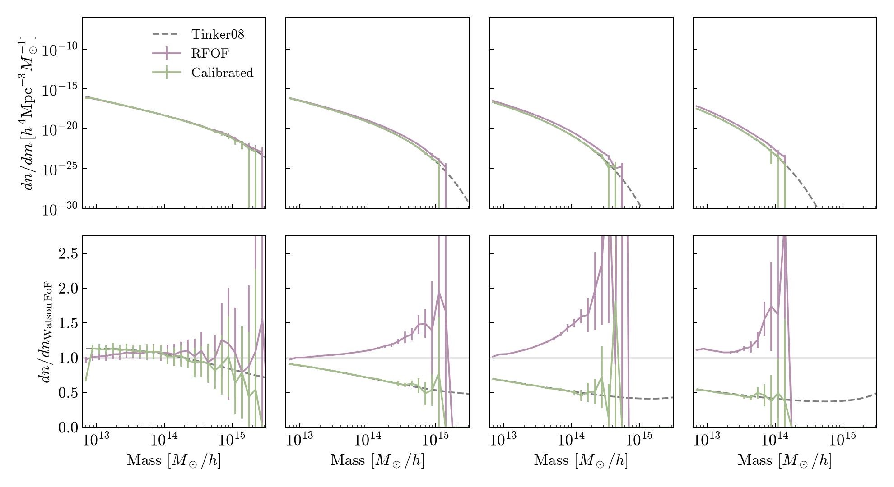

# HalfDome halo mass remapping

Reproduce the purple RFoF / green calibrated halo mass-function figure from the
HalfDome N-body paper, and apply the July 2024 RFoF-to-Tinker08 M200m calibration.

[HalfDome paper](https://arxiv.org/abs/2407.17462) ·
[Public data](https://halfdomesims.github.io/data/)

The runnable notebook is **[HalfDome_mass_remapping.ipynb](HalfDome_mass_remapping.ipynb)**.
It runs entirely from the small files included here. No NERSC connection,
`nbodykit`, Aemulus emulator, or historical container is needed to run it.

## What was recovered

The July plotting and catalog-conversion inputs survived in Zack Li's Perlmutter
IPython history. The original notebook filenames and original
`conversion_grid*.npy` tables were not recovered. The earlier
[June 5, 2024 Watson/Aemulus scripts](https://github.com/HalfDomeSims/HalfDome-DataRelease/tree/hmf_only)
are a different approach.

This repository provides two separate results:

* **Paper plot:** histogram counts from all 11 released HDF5 catalogs, including
  their existing calibrated masses. The plot does not depend on rebuilding the
  missing tables. The grey theory curves use a modern, pinned `hmf` installation.
* **Recovered mapping:** a cubic spline fitted to released pairs of original and
  calibrated masses, on the original 70 × 65 grid geometry. It is labelled as a
  reconstruction, not an original table. Independent validation and a
  conservative upper-mass support limit accompany it.



## Install and run

Python 3.12 and [uv](https://docs.astral.sh/uv/) are recommended:

```bash
uv sync --frozen --extra notebook --extra test
uv run python run.py plot --samples data/release_samples.npz --output /tmp/halfdome-HMF
uv run python -m pytest -q
```

Open `HalfDome_mass_remapping.ipynb` with the project's Python kernel, starting in
the repository root. The notebook writes PNG/PDF figures under
`~/projects/halfdome/recovered-remapping-20261027/validation/`; change `OUTPUT` to
choose another destination. An executed copy is included.

To rebuild the recovered table from the included released-catalog pairs:

```bash
uv run python run.py recover-grid \
  --samples data/release_samples.npz \
  --tail-samples data/release_tail_samples.npz \
  --output /tmp/halfdome-recovered-grid
```

## Apply to a catalog

```python
import numpy as np
from remapping import MassRemapping

mapping = MassRemapping.load("data/recovered-grid")
# redshift and log10_m_rfof are aligned arrays from a halo catalog.
log10_m200m = mapping.log10_m200m(redshift, log10_m_rfof)
m200m = 10**log10_m200m  # Msun/h
```

The historical correction is applied to **log mass**:

```text
log10(M200m) = log10(Mrfof) × [1 + spline(z, log10(Mrfof))]
```

It is not a multiplicative correction to linear mass. The released catalogs store
the RFoF log mass and redshift as float32; use those stored values when comparing
to the existing M200m fields. When preparing input from particle counts, the old
code used `log10(Length * M0 * 1e10)` and `1/Aemit - 1`, saved to float32. The
particle mass is approximately `1.9487254007799495e10 Msun/h`; the calibration
applies above 320 particles, about `6.236e12 Msun/h`.

For an HDF5 file containing `redshift` and `log10_m_rfof` (or `log10_m`), write a
new mass-only file with the same row order:

```bash
uv run python run.py apply --grid data/recovered-grid \
  --input halos.hdf5 --output calibrated-masses.hdf5
```

The input is read-only. Existing output files are not replaced. The sidecar
contains `halo_mass_m200m` and attributes identifying its source, units, mapping
provenance, and row alignment. Failed conversions leave no partial output.

## Recovery limits and validation

See [VALIDATION.md](VALIDATION.md) and
[`data/recovered-grid/provenance.json`](data/recovered-grid/provenance.json) for
the measured errors. Seed 100 and high-mass pairs from seeds 106–120 train the
reconstruction. Seed 102 is development validation; seed 104 is reserved for a
separate final check. Samples are stratified in mass and redshift and therefore
overrepresent rare massive halos.

The original grid's unconstrained high-mass continuation cannot be determined
uniquely from the released pairs. The default recovery support ends 0.25 dex
(five historical mass bins) below the local maximum training mass. This reserves
room for cubic interpolation near the sparse tail. Calls above that limit fail
explicitly. Passing `allow_extrapolation=True`, or the equivalent CLI flag,
permits the regularized continuation and historical boundary clamping; the
result is not established to match the original extrapolation.

The original interpolation grid covers redshift 0.025–3.475, although catalogs
extend to z=4. The historical code clamps to the grid boundaries; this is
preserved. New input below the original mass range is rejected by default.

If the original three NPY files are recovered, `MassRemapping.load(directory)`
can use them directly with the historical formula, without this fitted recovery.
The M200m→M200c step is preserved in the history archive but is not part of the
current runnable mapper. No fnl=20 production catalog has been modified or
claimed as validated by this recovery.

## Provenance

* [Raw recovered input history](provenance/perlmutter-remapping-history.json):
  July 4 spline smoothing; July 5, 17, and 22 paper plots; July 24 catalog writes.
  History timestamps do not record a timezone. These are archival inputs,
  including experiments and failed commands, not an executable pipeline.
* [`scripts/sample_release.py`](scripts/sample_release.py): reads the public
  catalogs under `/global/cfs/cdirs/cmb/halfdome/full_res/halos/`, exports the
  small stratified samples, and computes the four redshift-slice histograms.
* [`data/release_samples.json`](data/release_samples.json) and
  [`data/release_tail_samples.json`](data/release_tail_samples.json): source
  filenames, sizes, modification times, selected row intervals, and seeds.
* [`uv.lock`](uv.lock): package resolution; `requirements-lock.txt` additionally
  records the exact environment used for the first successful recovery.

The GitHub search checked the surviving `main`, `hmf_only`, and `validation_ic`
branches of HalfDome-DataRelease, repository forks and pull requests, relevant
personal repositories, and code/commit searches. No later GitHub copy of this
Tinker08 implementation was located. This does not establish whether a deleted
branch or repository once contained it.
